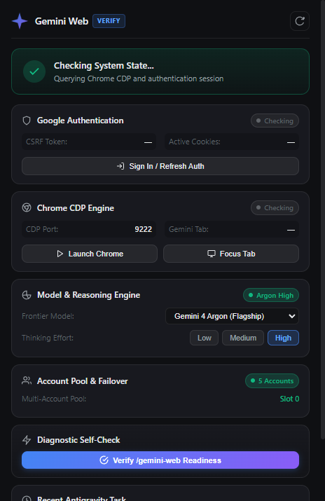
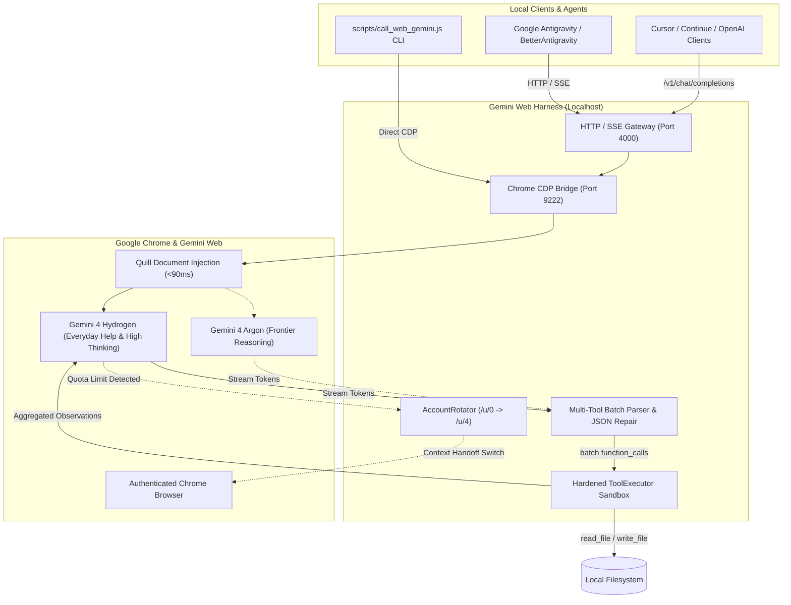

# 🌐 Gemini Web Harness

[](https://gemini.google.com)
[](https://gemini.google.com)
[](https://gemini.google.com)
[](https://chromedevtools.github.io/devtools-protocol/)
[](package.json)
[](https://gemini.google.com)
[](LICENSE)
[](https://nodejs.org)

**Gemini Web Harness** bridges Google's flagship **Gemini 4 Hydrogen** (Everyday Help with **High Thinking Effort**) and **Gemini 4 Argon** directly to your local development environment—including **Google Antigravity**, **BetterAntigravity**, **Cursor**, **Continue**, or your terminal—with **zero API costs ($0.00)**, **multi-tool batch execution** (`read_file`, `write_file`, `list_directory`, `run_command`), **Windows shell security sandboxing**, and automated **5-account quota failover**.

---

## 📺 Showcase & Video Demo

<table>
  <tr>
    <td width="45%" align="center" valign="top">
      <strong>🖥️ Live Cockpit GUI & Model Selector</strong><br><br>
      
    </td>
    <td width="55%" align="center" valign="top">
      <strong>🎬 Live Video Walkthrough & Demo</strong><br><br>
      <a href="https://www.youtube.com/watch?v=wriXu-QqnAU" target="_blank">
        
      </a>
      <br><br>
      <a href="https://www.youtube.com/watch?v=wriXu-QqnAU" target="_blank">▶️ <em>Click here to watch the full live demonstration on YouTube</em></a>
    </td>
  </tr>
</table>

---

## 🚀 Key Capabilities

- **⚡ Zero API Cost ($0.00)**: Routes reasoning directly through your authenticated Google Chrome session (`gemini.google.com`) with unmetered access to Google's flagship models.
- **🧪 Gemini 4 Hydrogen + High Thinking**: DeepMind's flagship Gemini 4 Hydrogen model with maximum High Thinking compute for agile, everyday pair-programming, codebase refactoring, and test execution.
- **🔬 Gemini 4 Argon Frontier Alternative**: Full support for Gemini 4 Argon when massive architectural reasoning and heavy cross-module synthesis are required.
- **⚙️ Multi-Tool Batch Execution Engine**: Executes multiple tools sequentially within a single turn (`read_file`, `write_file`, `list_directory`, `run_command`), aggregating all observations into a single prompt block to drastically reduce turn count and roundtrip latency.
- **🛡️ Hardened Windows Shell Security Sandbox**: Strict command injection defense blocking command chaining (`&`, `&&`, `;`), pipelines (`|`), redirection (`>`, `>>`, `<`), caret escapes (`^`), and newlines, with workspace directory traversal boundary enforcement.
- **🔄 Multi-Account Auto-Rotation (5 Accounts)**: Connect up to 5 Google accounts (`/u/0` through `/u/4`). When an account reaches its hourly quota, the harness detects the limit, compiles a context-handoff dossier, and rotates to the next available account with zero interruption.
- **🏎️ Ultra-Fast Quill Injection (<90ms)**: Bypasses slow DOM keyboard simulation by injecting prompts directly into Google's Quill internal document model.
- **📡 OpenAI & Anthropic-Compatible SSE Gateway**: Runs an HTTP server on port 4000 providing standard `/v1/chat/completions` streaming endpoints for easy integration with any IDE or coding agent.
- **🖥️ Live Desktop Cockpit**: Interactive Electron cockpit featuring real-time 60fps Chrome screencasting, model picker, account status chips, and 1-click diagnostic probe.

---

## 🏗️ Architecture



---

## ❓ Requirements & Ecosystem Compatibility

### Do I need BetterAntigravity or an Antigravity Tools repository?
**No!** Gemini Web Harness is **100% standalone and self-contained**.

- **Standalone Mode**: Runs independently with only **Node.js 18+** and standard **Google Chrome**. No external plugins, forks, or third-party packages are needed.
- **Google Antigravity / BetterAntigravity**: If you have Antigravity or BetterAntigravity, the harness natively integrates as the `/hydrogen` or `/gemini-web` command.
- **Cursor / Continue / Roo Code / OpenAI SDK**: Point any tool to `http://127.0.0.1:4000/v1` and use `gemini-4-hydrogen` or `gemini-4-argon` as an unmetered, zero-cost drop-in coding model.

---

## 📋 Prerequisites

1. **Google Chrome** (v120+ recommended).
2. **Node.js** (v18.0.0 or higher) and **npm**.
3. At least one signed-in Google account with access to [gemini.google.com](https://gemini.google.com).

---

## ⚡ Quick Start

### 1. Clone & Install

```bash
git clone https://github.com/giangero1/gemini-web-harness.git
cd gemini-web-harness
npm install
npm run build
```

### 2. Launch Chrome with Remote Debugging

Launch Chrome with remote debugging on port 9222 (with background anti-throttling):

**Windows (PowerShell):**
```powershell
& "C:\Program Files\Google\Chrome\Application\chrome.exe" --remote-debugging-port=9222 --disable-background-timer-throttling --disable-renderer-backgrounding "https://gemini.google.com/app"
```

*(Or simply run the automated helper: `powershell -File scripts/ensure_gemini_app.ps1`)*

**macOS:**
```bash
/Applications/Google\ Chrome.app/Contents/MacOS/Google\ Chrome --remote-debugging-port=9222 --disable-background-timer-throttling --disable-renderer-backgrounding "https://gemini.google.com/app"
```

**Linux:**
```bash
google-chrome --remote-debugging-port=9222 --disable-background-timer-throttling --disable-renderer-backgrounding "https://gemini.google.com/app"
```

### 3. Check Session Status

```bash
node scripts/call_web_gemini.js --status
```

---

## 💻 CLI & Autonomous Agent Usage

### Interactive Multi-Tool Codebase Analysis & Edit Loop
Have Gemini 4 Hydrogen Web inspect a local project and autonomously execute multiple tools per turn:

```bash
node scripts/call_web_gemini.js \
  --folder "./my-project" \
  --instruction "Analyze the architecture, run unit tests, and fix any failing tests." \
  --model "hydrogen" \
  --thinking-level "high"
```

### Full-Repo 1M Context Mode (ZIP Upload via CDP)
For whole-codebase analysis across all files:

```bash
node scripts/call_web_gemini.js \
  --folder "./my-project" \
  --upload-zip \
  --instruction "Audit the entire codebase for security vulnerabilities." \
  --model "hydrogen" \
  --thinking-level "high"
```

### Single File Audit
```bash
node scripts/call_web_gemini.js \
  --file "./src/index.ts" \
  --instruction "Refactor this file for optimal performance." \
  --model "hydrogen"
```

### Quick Prompt Streaming
```bash
node scripts/call_web_gemini.js \
  --prompt "Explain quantum computing in 3 sentences." \
  --model "hydrogen"
```

---

## 🔄 Multi-Account Auto-Rotation Pool

The harness manages up to 5 Google accounts (`gemini.google.com/u/0/app` through `/u/4/app`).

1. **Sign in to additional accounts** in Chrome by opening tabs `https://gemini.google.com/u/1/app`, `/u/2/app`, etc.
2. The harness monitors hourly quota reset notices in real-time.
3. If an account is locked (e.g. *"Limit resets at 4:24 AM"*):
   - The slot is automatically placed on cooldown.
   - A structured **Context Handoff Dossier** is generated (summarizing inspected files, modified files, and last tool outputs).
   - Chrome navigates to the next available account slot and resumes work seamlessly.

---

## 🔒 Security & Privacy Guarantees

- **100% Localhost Execution**: Prompts and tools run entirely between your local Chrome browser and local filesystem.
- **Zero-Leak Guarantee**: Active session cookies, CSRF tokens, and `.chrome-profile` data are strictly excluded from source control.
- **Sandboxed Command Whitelist**: Terminal tool execution is strictly sandboxed to safe development commands (`git`, `node`, `npm`, `tsc`, `python`, `pytest`, `cargo`, `go`, etc.).
- **Injection Defense**: Shell operators (`&`, `&&`, `;`, `|`, `>`, `<`, `^`, newlines) are rejected to prevent command chaining and subshell bypasses.
- **Directory Traversal Protection**: All filesystem reads and writes strictly enforce workspace boundaries.

---

## 🧪 Testing

Run the full TypeScript test suite across all 6 test suites:

```bash
npm test
```

### Test Suites Included:
1. `tests/account-rotator.test.ts` — Account URL generation, 12h AM/PM rate limit parsing, relative durations, and state persistence.
2. `tests/models-catalog.test.ts` — Catalog route exposure for Hydrogen, Argon, Pro, and Flash.
3. `tests/response-parser.test.ts` — Plain text streaming, function call extraction, and SSE formatting.
4. `tests/prompt-shim-antigravity.test.ts` — Context compilation and recursive workspace scanning.
5. `tests/tool-executor.test.ts` — Safe command execution, 12 shell injection vectors blocked, and path traversal boundaries.
6. `tests/agent-multitool.test.ts` — Multi-tool code block parsing, JSON arrays, inline calls, and syntax repair.

---

## 📄 License

This project is licensed under the [MIT License](LICENSE).
