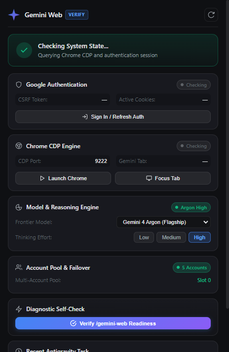
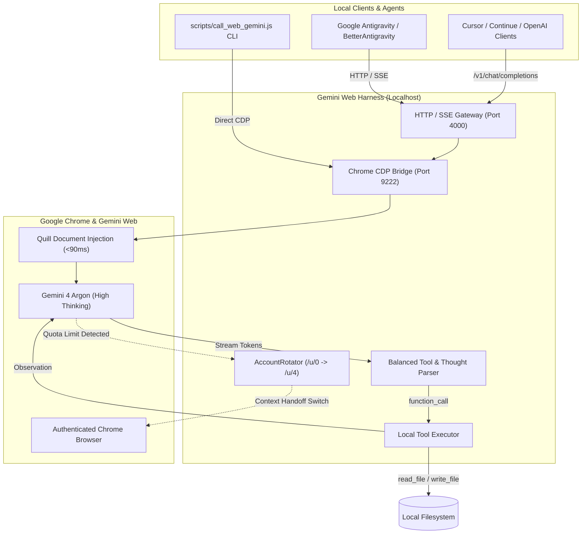

# 🌐 Gemini Web Harness

[](LICENSE)
[](https://nodejs.org)
[](https://chromedevtools.github.io/devtools-protocol/)
[](https://gemini.google.com)
[](https://gemini.google.com)
[](https://gemini.google.com)

**Gemini Web Harness** bridges Google's flagship **Gemini 4 Argon Web** (with **High Thinking Effort**) directly to your local development environment—including **Google Antigravity**, **BetterAntigravity**, **Cursor**, **Continue**, or your terminal—with **zero API costs**, local filesystem tool execution (`read_file`, `write_file`, `run_command`), and automated **5-account quota failover**.

---

## 📺 Showcase & Video Demo

<table>
  <tr>
    <td width="45%" align="center" valign="top">
      <strong>🖥️ Live Cockpit GUI & Model Selector</strong><br><br>
      
    </td>
    <td width="55%" align="center" valign="top">
      <strong>🎬 Live Video Walkthrough & Demo</strong><br><br>
      <a href="https://www.youtube.com/watch?v=wriXu-QqnAU" target="_blank">
        
      </a>
      <br><br>
      <a href="https://www.youtube.com/watch?v=wriXu-QqnAU" target="_blank">▶️ <em>Click here to watch the full live demonstration on YouTube</em></a>
    </td>
  </tr>
</table>

---

## ❓ Requirements & Ecosystem Compatibility

### Do I need BetterAntigravity or an Antigravity Tools repository?
**No!** Gemini Web Harness is **100% standalone and self-contained**.

- **Standalone Mode**: Runs independently with only **Node.js 18+** and standard **Google Chrome**. No external plugins, forks, or third-party packages are needed.
- **Google Antigravity / BetterAntigravity**: If you have Antigravity or BetterAntigravity, the harness natively integrates as the `/gemini-web` command.
- **Cursor / Continue / Roo Code / OpenAI SDK**: Point any tool to `http://127.0.0.1:4000/v1` and use `gemini-4-argon` as an unmetered, zero-cost drop-in coding model.

---

## 🚀 Key Capabilities

- **⚡ Zero API Cost ($0.00)**: Routes reasoning through your authenticated Google Chrome session (`gemini.google.com`) without requiring paid Google Cloud / Vertex AI credits.
- **🧠 Gemini 4 Argon + High Thinking**: Automatically enforces Gemini 4 Argon with maximum High Thinking compute in Google's UI for complex multi-file coding and deep reasoning.
- **🔄 Multi-Account Auto-Rotation (5 Accounts)**: Connect up to 5 Google accounts (`/u/0` through `/u/4`). When an account reaches its hourly quota, the harness detects the limit, compiles a context-handoff dossier, and rotates to the next available account with zero interruption.
- **🛠️ Autonomous Local Tool Loop**: Gemini 4 Argon can autonomously inspect directory trees, read local files, write/edit code, and run tests/commands via balanced tool extraction.
- **🏎️ Ultra-Fast Quill Injection (<90ms)**: Bypasses slow DOM keyboard simulation by injecting prompts directly into Google's Quill internal document model.
- **📡 OpenAI & Anthropic-Compatible SSE Gateway**: Runs an HTTP server on port 4000 providing standard `/v1/chat/completions` streaming endpoints for easy integration with any IDE or coding agent.
- **🖥️ Live Desktop Cockpit**: Interactive Electron cockpit featuring real-time 60fps Chrome screencasting, model picker, account status chips, and 1-click diagnostic probe.

---

## 🏗️ Architecture



---

## 📋 Prerequisites

1. **Google Chrome** (v120+ recommended).
2. **Node.js** (v18.0.0 or higher) and **npm**.
3. At least one signed-in Google account with access to [gemini.google.com](https://gemini.google.com).

---

## ⚡ Quick Start

### 1. Clone & Install

```bash
git clone https://github.com/giangero1/gemini-web-harness.git
cd gemini-web-harness
npm install
npm run build
```

### 2. Launch Chrome with Remote Debugging

Launch Chrome with remote debugging on port 9222:

**Windows (PowerShell):**
```powershell
& "C:\Program Files\Google\Chrome\Application\chrome.exe" --remote-debugging-port=9222 "https://gemini.google.com/app"
```

**macOS:**
```bash
/Applications/Google\ Chrome.app/Contents/MacOS/Google\ Chrome --remote-debugging-port=9222 "https://gemini.google.com/app"
```

**Linux:**
```bash
google-chrome --remote-debugging-port=9222 "https://gemini.google.com/app"
```

*(Alternatively, launch the Cockpit GUI and click **Launch Chrome**).*

### 3. Open the Desktop Cockpit

```bash
npm start
```
Click **Verify /gemini-web Readiness** in the Cockpit to confirm connection (<100ms probe).

---

## 💻 CLI & Autonomous Agent Usage

### Interactive Codebase Analysis & Edit Loop
Have Gemini 4 Argon Web inspect a local project and autonomously execute tools:

```bash
node scripts/call_web_gemini.js \
  --folder "./my-project" \
  --instruction "Analyze the architecture, run unit tests, and fix any failing tests." \
  --model "argon" \
  --thinking-level "high"
```

### Single File Audit
```bash
node scripts/call_web_gemini.js \
  --file "./src/index.ts" \
  --instruction "Refactor this file for optimal performance."
```

### Quick Prompt Streaming
```bash
node scripts/call_web_gemini.js \
  --prompt "Explain quantum computing in 3 sentences."
```

---

## 🔄 Multi-Account Auto-Rotation Pool

The harness manages up to 5 Google accounts (`gemini.google.com/u/0/app` through `/u/4/app`).

1. **Sign in to additional accounts** in Chrome by opening tabs `https://gemini.google.com/u/1/app`, `/u/2/app`, etc.
2. The harness monitors hourly quota reset notices in real-time.
3. If an account is locked (e.g. *"Limit resets at 4:24 AM"*):
   - The slot is automatically placed on cooldown.
   - A structured **Context Handoff Dossier** is generated (summarizing inspected files, modified files, and last tool outputs).
   - Chrome navigates to the next available account slot and resumes work seamlessly.

---

## 🔒 Security & Privacy Guarantees

- **100% Localhost Execution**: Prompts and tools run entirely between your local Chrome browser and local filesystem.
- **No Third-Party Relays**: All authentication tokens and cookies remain inside your local Chrome profile and are never transmitted to external servers.
- **Safe Command Whitelist**: Terminal tool execution is strictly sandboxed to safe development commands (`git`, `node`, `npm`, `tsc`, `python`, `pytest`, `cargo`, `go`, etc.).

---

## 🧪 Testing

Run the test suite:

```bash
# Run Response Parser streaming tests
npx ts-node tests/response-parser.test.ts

# Run Account Rotator & clock parser tests
npx ts-node tests/account-rotator.test.ts
```

---

## 📄 License

This project is licensed under the [MIT License](LICENSE).
